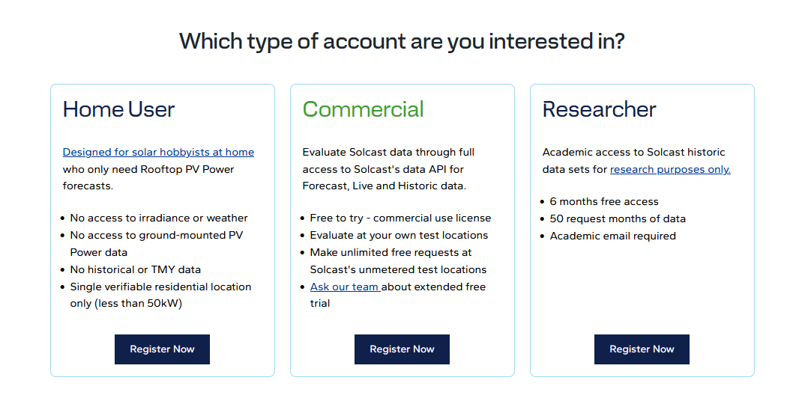
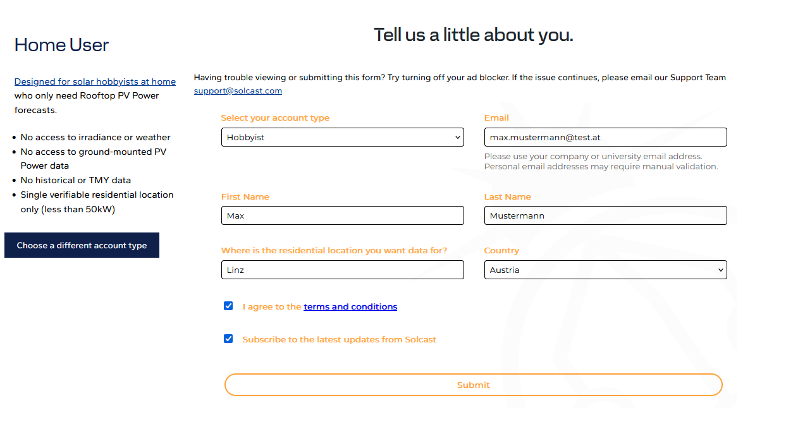
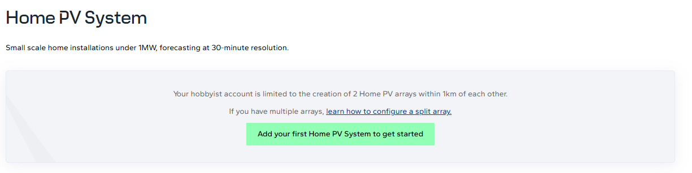
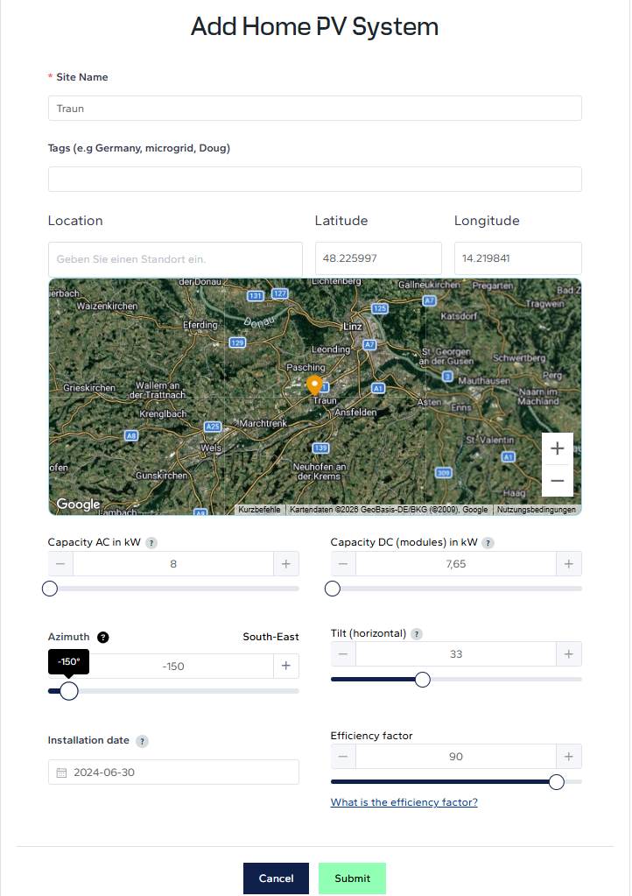
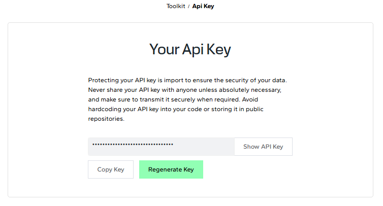
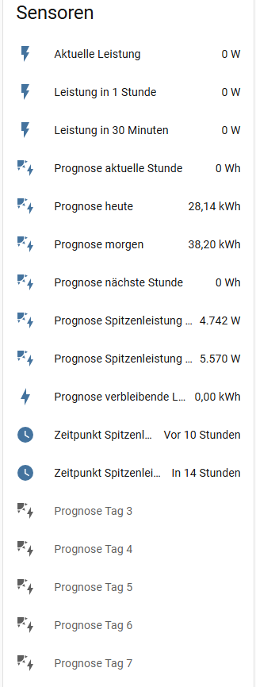

# Solcast Solar einrichten

## 1. Bei Solcast registrieren

1. Registriere dich auf [toolkit.solcast.com.au](https://toolkit.solcast.com.au/).
2. Wähle den Accounttyp **Home User**. 
   
3. Wähle **Hobbyist**, gib deine Daten ein und klicke auf **Submit**. 
   
4. Wähle ein Passwort und klicke auf **Submit**.
5. Öffne den Link in der Bestätigungs-E-Mail.
6. Melde dich an.
7. Klicke auf **„Add your first Home PV System to get started"**. 
   
8. Gib deine Anlage ein:
    - **Capacity (kW)** — Anlagenleistung in kWp (z.B. 10)
    - **Tilt** — Dachneigung in Grad (typisch 30–35°)
    - **Azimuth** — Ausrichtung: 0° = Nord, -90° = Ost, ±180° = Süd, 90° = West

    Klicke auf **Submit**. 
    

9. **Mehrere Ausrichtungen (Ost/West)?** Klicke auf **„Add another PV System"** und gib die zweite Dachfläche extra ein. Beide nutzen denselben API-Key.
10. Öffne oben rechts das Menü neben deinem Namen und klicke auf **Your API Key**.
11. Kopiere den Key (deinen Zugangsschlüssel) für später. 
    

## 2. Integration installieren — nur bei selbst eingerichtetem Gerät

> [!NOTE]
> **Vorbereitetes EEG-Gerät (Home Assistant Green) erhalten?** Dann ist Solcast schon installiert. **Überspringe diesen Abschnitt** und mach bei **3. API-Key in Home Assistant eintragen** weiter.

_**Voraussetzung:** [HACS](https://hacs.xyz/) ist installiert (Solcast ist nicht in Home Assistant enthalten)._

1. Suche in **HACS** nach **„Solcast PV Forecast"**
2. Installiere die Integration und starte Home Assistant neu.

## 3. API-Key in Home Assistant eintragen

_Das gilt für **alle**, auch beim vorbereiteten EEG-Gerät — jedes Mitglied hat seinen eigenen Key._

Den Key trägst du in der Solcast-Integration ein, **nicht** im EEG Energy Optimizer:

1. Klicke links unten auf **Einstellungen**, dann auf **Geräte & Dienste**.
2. Klicke rechts unten auf **„+ Integration hinzufügen"**.
3. Tippe **„Solcast"** ein und wähle **Solcast PV Forecast**.
4. Füge im Feld **API-Key** deinen Key ein (Rechtsklick → Einfügen bzw. lange auf das Feld tippen). Lass den Rest wie vorgegeben und klicke auf **OK** bzw. **Absenden**.
5. Schalte die Prognose-Sensoren für die Tage 3 bis 7 ein: Sensor anklicken, Zahnrad, **Aktiviert**. 
   

> [!TIP]
> **Solcast taucht in der Suche nicht auf?** Dann ist die Integration nicht installiert — siehe Abschnitt 2. **Meldung „Ungültiger API-Key"?** Kopiere den Key noch einmal (oben rechts im Menü → **Your API Key**), ohne Leerzeichen am Anfang oder Ende.

## 4. Prüfen

1. Warte 1–2 Minuten
2. Suche unter **Entwicklerwerkzeuge → Zustände** nach `solcast`
3. `sensor.solcast_pv_forecast_prognose_verbleibende_leistung_heute` (was heute **noch** kommt, nicht die Tagessumme) und `sensor.solcast_pv_forecast_prognose_morgen` sollten kWh-Werte zeigen. Ältere Versionen heißen `…_prognose_fuer_heute` und `…_prognose_fuer_morgen`
4. Kehre hierher zurück — die Sensoren werden automatisch zugeordnet
