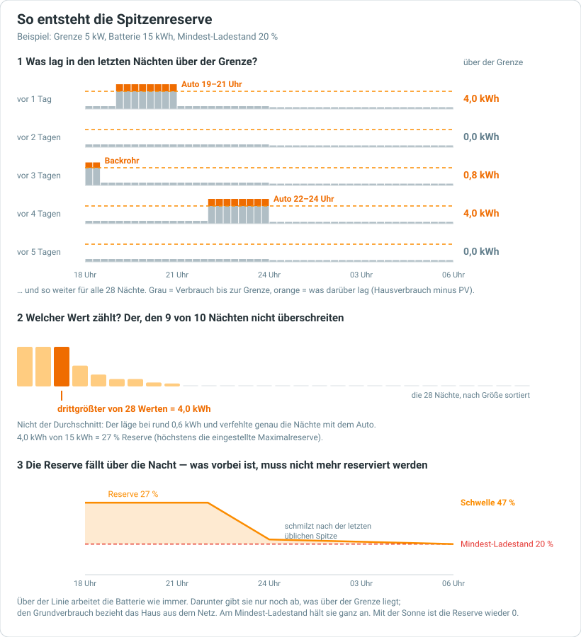

# Spitzenkappung

Mit der neuen Tarifstruktur hängt ein Teil der Netzgebühr an deiner **Bezugsspitze**. Das ist der höchste Netzbezug des ganzen Monats, gemittelt über eine Viertelstunde. Netzbezug heißt: Strom, den du aus dem Netz holst. Die Regel kommt aus dem Elektrizitätswirtschaftsgesetz (ElWG).

Ab wann das für dich gilt, legt dein Netzbetreiber fest (siehe Anleitung „Dashboard"):

- frühestens ab 1.1.2027
- ohne eigene Meldung des Netzbetreibers ab 1.12.2027
- spätestens ab 1.7.2028

Schon eine einzige Viertelstunde zählt: Laufen Auto, Herd und Wärmepumpe gleichzeitig, legt diese Viertelstunde den Preis für den ganzen Monat fest. Die Spitzenkappung hält solche Viertelstunden niedrig. Sie arbeitet in zwei Stufen:

1. **Die Batterie.** Solange sie genug Energie hat, deckt sie Spitzen ohnehin. Wird sie knapp, hält sie eine **Reserve** zurück. Aus dieser Reserve gibt sie nur noch ab, was über deiner Grenze liegt. Den Grundverbrauch holt sich das Haus dann aus dem Netz.
2. **Verbraucher abschalten.** Reicht die Batterie nicht, schaltet die Integration die Verbraucher ab, die du einträgst, einen nach dem anderen. Das passiert etwa, wenn die Batterie leer ist oder das Auto mehr zieht, als sie liefern kann. Sobald wieder Platz ist, schaltet sie die Verbraucher wieder ein.

> [!NOTE]
> Die erste Stufe gibt es derzeit mit **Huawei**, **Fronius**, **SMA** und **SolaX**. Mit den anderen Wechselrichtern kappt die Integration derzeit nur über das Abschalten von Verbrauchern.

## Wie es funktioniert

### Die Grenze

- Du stellst eine **Grenze** in kW ein. Darunter wird nie gekappt.
- Brauchst du regelmäßig viel Leistung, trägst du diesen Wert ein. Beispiel: Dein Auto lädt jeden Abend mit 5 kW, also stellst du 5 kW ein. Dann versucht die Integration gar nicht erst, darunter zu bleiben.
- Ist die Bezugsspitze des Monats schon höher als die Grenze, gilt die Monatsspitze. Bis zu diesem Wert kostet eine Viertelstunde nichts mehr.
- Unter 2 kW geht es nicht. So viel wird ohnehin mindestens verrechnet.

**Gezählt wird das Viertelstundenmittel**, wie beim Netzbetreiber. Das ist der Durchschnitt über die ganze Viertelstunde, nicht der Wert in einem Augenblick. Ein Wasserkocher, der zwei Minuten läuft, kostet deshalb keine Batterie, solange der Rest der Viertelstunde ruhig ist.

### Die Reserve

Ein fester Prozentwert wäre zu klein (die Spitze kommt trotzdem) oder zu groß (das Haus kauft die zurückgehaltene Energie jede Nacht teuer aus dem Netz). Deshalb **rechnet** die Integration die Reserve:

- **Rückblick:** Sie schaut auf die letzten **vier Wochen**. Wie viel Strom hat das Haus zu jeder Uhrzeit über der Grenze gebraucht? Gerechnet wird Hausverbrauch minus PV, je Viertelstunde. Was mehr ist, als die Batterie abgeben kann, zählt nicht mit. Das kann sie ohnehin nicht kappen.
- **Bis zur nächsten Sonne:** Die Reserve ist die Energie, die von **jetzt** bis zur nächsten Sonne noch über der Grenze gebraucht wird. Gezählt wird so viel, wie **9 von 10** vergleichbaren Tagen nicht überschritten haben. Beispiel: Lädt das Auto eine Nacht pro Woche, ist diese Nacht abgedeckt. Ein Durchschnitt würde genau diese Nacht verfehlen.
- **Sinkt über die Nacht:** Was schon vorbei ist, braucht keine Reserve mehr. Kurz vor Sonnenaufgang hält die Batterie fast nichts mehr zurück. Den Rest gibt sie wieder fürs Haus frei.

Die Werte kommen aus der Statistik von Home Assistant. Beim ersten Einschalten liegen dort meist schon die letzten zehn Tage. Die Integration führt sie dann selbst auf vier Wochen fort. Solange weniger als **sieben** vergleichbare Tage da sind, gilt nur die Mindestreserve.

Die Reserve kommt immer **oben auf den Mindest-Ladestand** (Tab **Anlage**). Der Ladestand (auch SOC) sagt, wie voll die Batterie ist, in Prozent. Beispiel: Bei 10 % Mindest-Ladestand und 20 % Reserve hält die Batterie unter 30 % Energie zurück. Den Mindest-Ladestand selbst unterschreitet sie auch für Spitzen nicht.

### Was die Batterie in der Reserve tut

Über der Reserve läuft alles wie bisher. Darunter begrenzt die Integration alle 30 Sekunden, wie viel Leistung die Batterie abgeben darf:

- **Verbrauch unter der Grenze:** Die Batterie gibt nichts ab. Das Haus bezieht seinen Grundverbrauch aus dem Netz.
- **Verbrauch über der Grenze:** Die Batterie gibt genau den Teil ab, der über der Grenze liegt.
- **Sicherheitsabstand:** Die Batterie regelt nicht genau auf die Grenze, sondern auf 0,3 kW darunter. So bleibt die Viertelstunde auch bei kleinen Schwankungen unter der Grenze.
- **Kleinigkeiten:** Müsste die Batterie weniger als 0,2 kW abgeben, gibt sie gar nichts ab. Hält sie gerade zurück, beginnt sie erst wieder ab 0,4 kW. So springt der Wert nicht ständig zwischen „halten“ und „abgeben“ hin und her.

Auch der Fahrplan rechnet die Reserve mit ein:

- Am Abend verkauft er nicht mehr, was in der Nacht für Spitzen gebraucht wird.
- Tagsüber soll die Batterie am Ende der Sonnenstunden mindestens Mindest-Ladestand plus Abendreserve erreichen. Ist das **Ladeziel** (Tab **Anlage**) höher, gilt das Ladeziel.
- Liegt die Batterie unter der Reserve, etwa morgens nach einer Nacht mit Spitzen, rechnet der Plan vom tatsächlichen Ladestand aus und lädt sie wieder auf.
- Im Modus **Aus** und während einer **Pause** rechnet der Plan ohne Reserve.

> [!NOTE]
> Hast du das Ladeziel ausgeschaltet, erscheint tagsüber trotzdem eine Ladeziel-Marke im Ladestandsdiagramm: Das ist die Abendreserve.

### Verbraucher abschalten

**Wann schaltet die Integration ab?**

- Immer in der Reihenfolge deiner Liste.
- Nur, wenn die Batterie die Spitze nicht mehr decken kann.
- Nur, wenn der Verbraucher gerade läuft (ab 0,2 kW).

Ob die Batterie noch mehr könnte, weiß die Integration derzeit nur bei Huawei, Fronius, SMA und SolaX. Bei den anderen Wechselrichtern rechnet sie ohne die Batterie. Sie schaltet dann ab, sobald die Viertelstunde über die Grenze zu gehen droht.

Nach jedem Abschalten wartet sie 60 Sekunden, denn ein Auto regelt langsam herunter und meldet seine Leistung oft verzögert.

**Wann schaltet sie wieder ein?**

- Frühestens nach 5 Minuten.
- Nur, wenn der Verbraucher neben dem übrigen Haus eine ganze Viertelstunde lang unter die Grenze passt. Die Batterie zählt dabei nicht mit, sonst würde der Verbraucher die Reserve leeren.

Beispiel: Ein 11-kW-Auto kommt bei einer Grenze von 5 kW erst zurück, wenn die Spitze vorbei ist und der Monat eine höhere Spitze erlaubt.

Damit nichts hin- und herpendelt:

- **Leistung des Verbrauchers:** Es zählt die **höchste Leistung der letzten fünf Minuten** vor dem Abschalten. Ein Auto, das beim Abschalten gerade erst auf 2 kW hochregelt, gilt so nicht als 2-kW-Verbraucher. Hast du eine **Nennleistung** eingetragen und ist sie größer, gilt sie.
- **Wartezeit:** Muss ein Verbraucher innerhalb von 15 Minuten nach dem Wiedereinschalten erneut aus, **verdoppelt sich seine Wartezeit**: 5, 10, 20, 40, höchstens 60 Minuten. Nach einer Stunde ohne erneutes Abschalten gelten wieder 5 Minuten. Ein Neustart von Home Assistant setzt das nicht zurück.

Schaltest du einen Verbraucher von Hand wieder ein, bleibt er an. Die Integration greift erst bei der nächsten Spitze wieder ein. Ist die Optimierung aus, pausiert oder die Spitzenkappung abgeschaltet, schaltet sie alles wieder ein, was sie abgeschaltet hat.

> [!TIP]
> **Gut geeignet** sind Verbraucher, die nach dem Wiedereinschalten selbst langsam hochfahren, etwa eine Wallbox mit Ladeprofil. **Schlecht geeignet** sind Geräte, die sofort mit voller Leistung starten oder nach dem Abschalten eine lange Mindestpause brauchen, etwa manche Wärmepumpen.

## Einrichtung

Die Spitzenkappung findest du in den **Einstellungen** im Tab **Spitzenkappung**.

| Feld | Bedeutung |
|---|---|
| **Bezugsspitzen kappen** | Schaltet die Funktion ein oder aus |
| **Grenzwert (kW)** | 2 bis 20 kW, Vorgabe 5. Darunter wird nichts gekappt |
| **Mindestreserve (%)** | Derzeit nur mit Huawei, Fronius, SMA oder SolaX. So viel hält die Batterie immer für Spitzen zurück, auch wenn die Statistik weniger verlangt. Vorgabe 0 |
| **Maximalreserve (%)** | Derzeit nur mit Huawei, Fronius, SMA oder SolaX. Mehr hält die Batterie nie zurück. Vorgabe 30. Ein leeres Feld heißt ebenfalls 30, 0 schaltet die Reserve ab |
| **Verbraucher** | Bis zu zehn, in der Reihenfolge, in der abgeschaltet wird. Je Verbraucher brauchst du einen **Leistungssensor** (W oder kW) und einen **Schalter** (`switch.` oder `input_boolean.`). Optional trägst du die **Nennleistung** in kW ein |

Ohne Batterie-Stufe (andere Wechselrichter) brauchst du mindestens einen Verbraucher. Sonst täte die Funktion nichts.

**Wann lohnt sich eine Mindestreserve?** Wenn ein großer Verbraucher neu ist, etwa ein E-Auto: 5 bis 10 % überbrücken die Zeit, bis die Statistik (letzte vier Wochen) ihn kennt. Sonst lass sie bei 0, denn sie hält die Batterie auch in Nächten ohne Spitze zurück.

_Alle Felder wirken ohne Neustart der Integration._

## Anzeige

- **Karte „Bezugsspitze & Spitzenkappung"** im Dashboard: Sie zeigt die Monatsspitze, die laufende Viertelstunde im Vergleich zur Schwelle und die Tagesspitzen des Monats. Darunter steht, was die Spitzenkappung gerade tut:
  - Stufe 1 (Batterie) mit Ladestand, Mindest-Ladestand und dem Ladestand, bis zu dem die Reserve reicht
  - Stufe 2 (Verbraucher) mit dem Zustand jedes Geräts

  Mehr dazu in der Anleitung „Dashboard".
- **Statuskarte, Zeile „Bezugsspitze":** Greift die Spitzenkappung gerade, steht dort ein Hinweis: „Batterie hält Reserve", „Batterie deckt nur Spitzen" oder „Wallbox aus". Ein Tipp darauf springt zur Karte.
- **Fahrplan, Ladestandsdiagramm:** Die orange gestrichelte Linie über dem Mindest-Ladestand ist die **Spitzenreserve** je Viertelstunde. Unter dieser Linie deckt die Batterie nur noch Spitzen. Ist die Reserve 0, fehlt die Linie.
- **Einstellungen, Tab Spitzenkappung:** Oben steht der aktuelle Stand in einem Satz.
- **Fahrplan-Status:** Der Statussensor zeigt „Spitzenkappung: Batterie hält Reserve" oder „… deckt Spitzen". Die Begründung steht im Attribut `status`.
- **Aktivitätsprotokoll:** Jedes Ab- und Einschalten eines Verbrauchers steht dort mit Grund.

**Reserve 0 %** heißt: In den letzten vier Wochen lag kein Verbrauch über der Schwelle. Die Schwelle ist deine Grenze oder, wenn sie schon höher ist, die aktuelle Monatsspitze; die Karte nennt den Wert. Die Batterie arbeitet normal und hält erst am Mindest-Ladestand an. Mit eingeschalteter Spitzenkappung ist der Mindest-Ladestand eine echte Untergrenze, auch im Automatikbetrieb.

## Gut zu wissen

- **Optimierung aus oder Pause:** Die Spitzenkappung tut nichts. Die Batterie läuft im Automatikbetrieb, abgeschaltete Verbraucher kommen zurück.
- **Absturz von Home Assistant:**
  - **Fronius** und **SMA** geben die Batterie nach spätestens fünf Minuten von selbst frei.
  - Bei **Huawei** bleibt die gesetzte Entladeleistung im Wechselrichter stehen, bis Home Assistant wieder läuft. Ist die Spitzenkappung beim Start eingeschaltet, setzt die Integration sie auf das Maximum zurück. Hast du die Spitzenkappung in der Zwischenzeit ausgeschaltet, prüf die Entität **Maximale Entladeleistung** und stell sie von Hand zurück.
- **SolaX:** Die Integration stellt den maximalen Entladestrom (`battery_discharge_max_current`). Wie bei Huawei bleibt er bei einem Absturz stehen. Den Wert, der vorher eingestellt war, sichert die Integration und stellt ihn beim Aufheben wieder her. Am Gerät ist das noch nicht geprüft. Wer es testet, schaut auf diese Entität.
- **Huawei, Entladeleistung:** Die Integration stellt die Number-Entität **Maximale Entladeleistung**. Gibt sie die Batterie frei, setzt sie diesen Wert auf das Maximum des Geräts zurück. Ein eigener, niedrigerer Wert, der dort vorher stand, geht dabei verloren.
- **Kosten:** Die Spitzenkappung rechnet nicht nach, ob sie sich lohnt. Eingeschaltet heißt: Sie kappt. Was die Monatsspitze kostet, steht im ⓘ der Zeile „Bezugsspitze" (siehe Anleitung „Dashboard").
